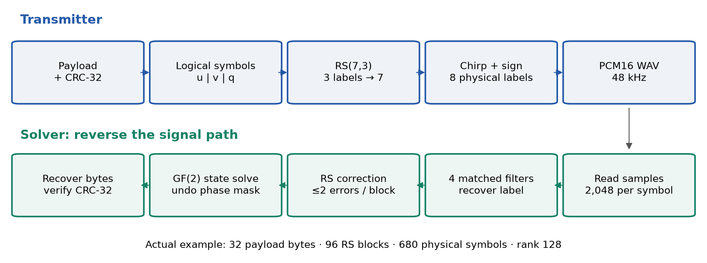
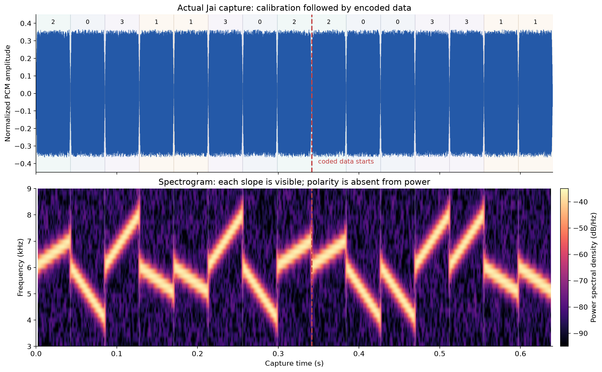
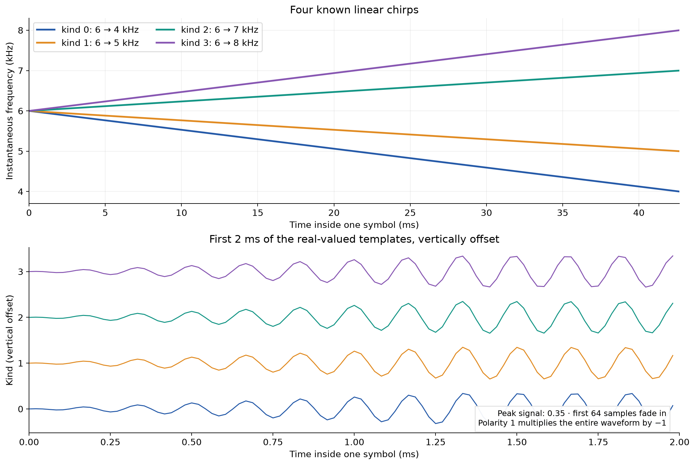
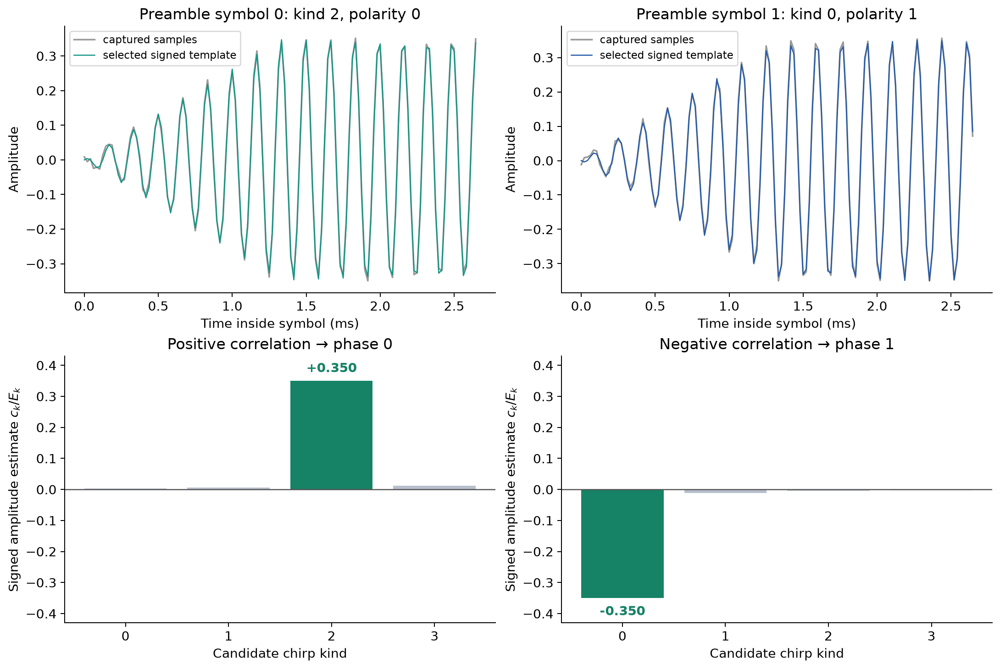
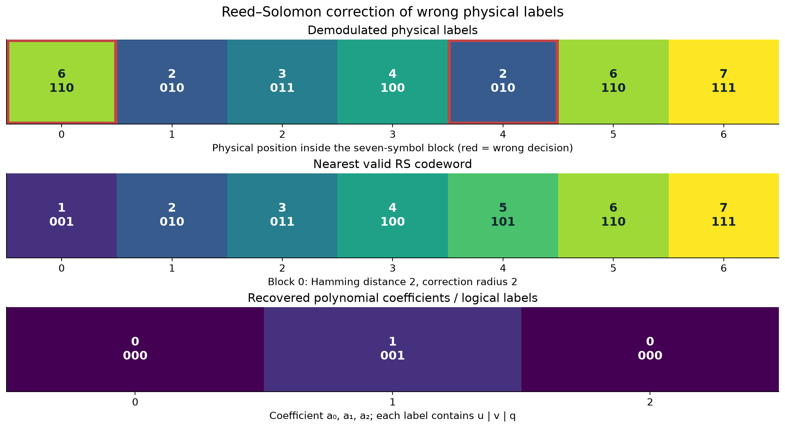
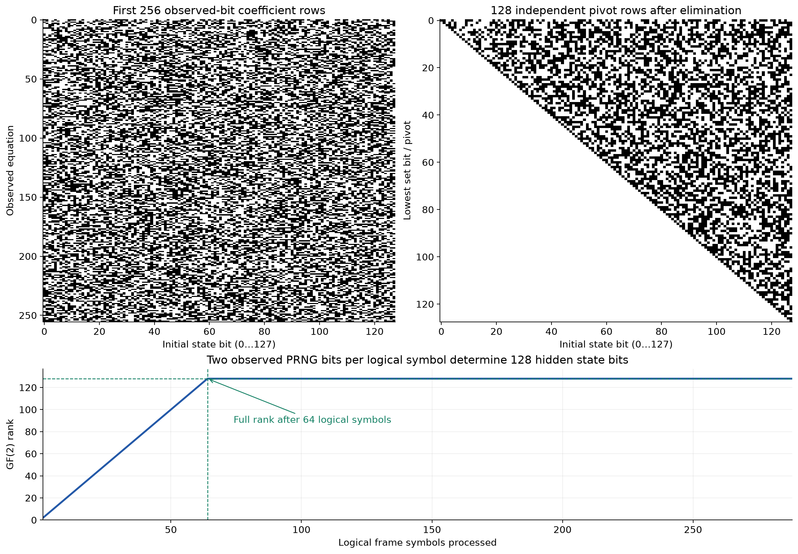
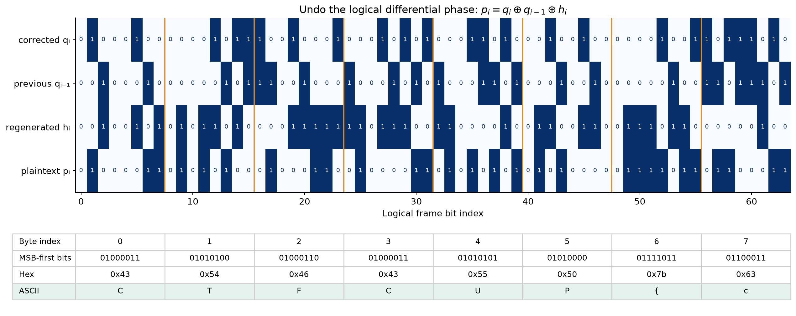
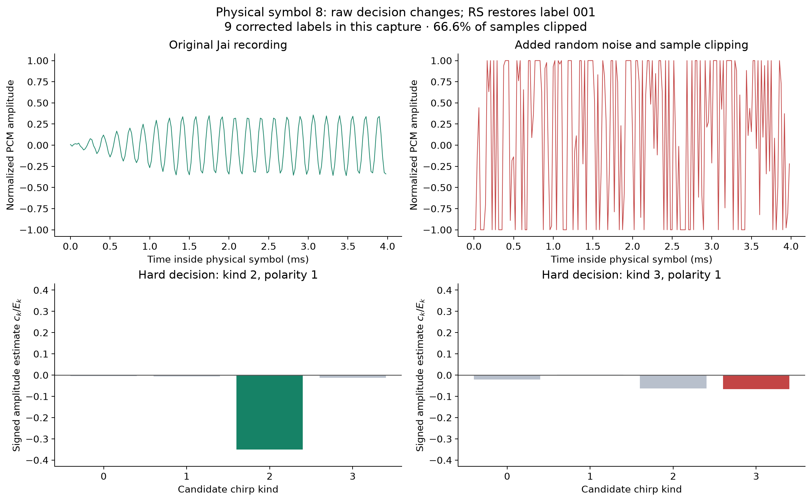

# Maintenance window: recovering a flag from chirp telemetry

This writeup explains the **current Jai challenge**, including its RS(7,3) error
correction. It follows the solve from a sampled waveform to a verified flag, with
figures generated by Matplotlib from a real transmitter capture. The standalone
[Python solver](solve.py) needs neither the Jai compiler nor the author decoder.

The included example flag is:

```text
CTFCUP{chirps_leak_linear_state}
```

It is an illustrative payload, not a competition secret. The example recording
was produced by the existing `build/transmitter`; its hidden state was recovered
from the recording rather than supplied to the solver. All new scripts, examples,
and figures live in this directory. Creating them did not edit the existing
challenge files; source compilation for validation used temporary copies.

## 1. The solve in one picture



The transmitter makes three decisions for each **logical frame bit**. Two bits
from a linear generator become a selector, while a third generator bit masks the
plaintext through a differential phase equation. These three bits form a small
symbol. Error correction expands groups of three symbols into groups of seven.
Finally, each encoded symbol chooses a chirp waveform and its sign.

We reverse those transformations in the opposite order:

1. Read the WAV and divide it into fixed-size physical symbols.
2. Identify a chirp and polarity for each physical symbol.
3. Decode each seven-symbol Reed–Solomon block.
4. Extract the two exposed generator bits per logical symbol.
5. Recover the generator's initial 128-bit state with GF(2) elimination.
6. Regenerate the hidden masking bits and recover frame bytes.
7. Verify and remove the CRC-32 trailer.

The important distinction is between **physical symbols**, which exist in the
recording, and **logical symbols**, which exist before error correction. The PRNG
advances for logical symbols, never for physical parity symbols or padding.

## 2. Reproduce the demonstration

From this directory:

```sh
python3 solve.py examples/demo.wav
python3 solve.py examples/demo-corrupted.wav
python3 solve.py examples/demo-noisy.wav
```

All three commands recover the same example flag. To save the exact payload bytes
and a diagnostic report:

```sh
python3 solve.py examples/demo.wav -o recovered.bin --report report.json
```

Diagnostics go to stderr. The recovered UTF-8 payload goes to stdout; binary
payloads are printed using a byte representation. `-o` always saves the exact raw
payload bytes. The JSON report includes state words, rank, correction counts,
padding, and the verified checksum. Keep input and output paths distinct.

For another challenge capture:

```sh
python3 solve.py /path/to/capture.wav
```

The current transmitter takes a **literal flag argument**, not a payload-file or
seed-file argument. For example, from this directory:

```sh
../build/transmitter 'CTFCUP{another_example_payload}' /tmp/another-capture.wav
python3 solve.py /tmp/another-capture.wav
```

It reads both its secret state and sample noise from `/dev/urandom`. The current
source fixes the noise peak at 0.015; there is no runtime noise-strength option.
The solver intentionally matches this source version. Earlier uncoded recordings
use a different format and are outside its scope.

Dependencies are listed in [requirements.txt](requirements.txt). Tested versions
are Python 3.14.7, NumPy 2.5.3, and Matplotlib 3.11.2. NumPy is needed for solving;
Matplotlib is only needed to regenerate graphics.

## 3. What reversing the executable needs to reveal

The player-facing executable is stripped, so source function names should not be
expected in a decompiler. The names used below describe the recovered behavior.
An author can compare that behavior against `protocol.jai` and `fec.jai`, but the
solver reads only the WAV and its hardcoded protocol constants.

Following the file-writing path establishes the waveform layout. The RIFF header
construction reveals mono PCM, a sample rate of 48,000 Hz, and 16-bit samples.
The waveform loop runs for 2,048 samples, uses a cosine, and scales into signed
PCM. Its initial/final fades are 64 samples. The endpoint table distinguishes
four chirps. A separate loop emits eight initial calibration symbols.

Following the data preparation path reveals three more structures:

- A four-word generator updated through XOR, shift, and rotation, with a parity
  output selected by two constant masks.
- A small finite-field encoder that multiplies through shifts and conditionally
  XORs `0b1011`, then evaluates three coefficients at seven field elements.
- A reflected CRC loop using `0xEDB88320`, with all-one initialization and final
  XOR.

These constants are sufficient to reconstruct the intended protocol:

| Property | Recovered value |
| --- | --- |
| PCM | Signed 16-bit, little-endian, mono |
| Sample rate | 48,000 samples/s |
| Physical symbol length | 2,048 samples |
| Symbol duration | 42.6667 ms |
| Chirp start frequency | 6 kHz |
| Chirp endpoint table | 4, 5, 7, 8 kHz |
| Selector-to-kind permutation | `[2, 0, 3, 1]` |
| Calibration length | 8 physical symbols |
| Source label width | 3 bits: `u | v | q` |
| Error correction | RS(7,3), GF(8), modulus `x³+x+1` |
| Payload trailer | Four-byte little-endian CRC-32 |
| Frame bit order | Most-significant bit first |

The simulation's absolute sample rate is specified by the WAV header. The exact
symbol duration, generator call schedule, permutation, and coding conventions
still come from reversing the executable.

## 4. Read the recording without losing framing

The challenge emits a canonical 44-byte WAV header. A 16-bit sample consumes two
bytes, so each physical symbol occupies 4,096 bytes of sample data. For a WAV of
length `L`:

```text
physical_symbols = (L − 44) / 4096
data_symbols     = physical_symbols − 8
RS_blocks        = data_symbols / 7
source_labels    = RS_blocks × 3
frame_bytes      = floor(source_labels / 8)
padding_labels   = source_labels − frame_bytes × 8
payload_bytes    = frame_bytes − 4
```

All divisions except the explicit floor must be exact. Padding must be zero,
one, or two labels. The solver checks those constraints, both WAV length fields,
the PCM format, and the transmitter's 8–4096-byte payload range before solving.

For the included baseline:

```text
680 physical symbols
  8 calibration symbols
672 encoded data symbols = 96 RS blocks × 7
288 source labels        = 96 RS blocks × 3
 36 frame bytes          = 32 payload bytes + 4 CRC bytes
  0 padding labels
```

The total duration is about 29.013 seconds. Only the first 15 physical symbols
are displayed in the overview below so individual frequency sweeps remain clear.



The dashed boundary marks the end of the eight-symbol preamble. Bright tracks in
the spectrogram reveal the chirp directions and slopes. A waveform's sign cannot
be read from this power spectrogram: negation changes its phase by π but preserves
its power. We must retain signed samples for phase recovery.

`read_capture()` uses an explicit little-endian NumPy buffer view, rather than
assuming the machine's native byte order. See
[NumPy's `frombuffer` documentation](https://numpy.org/doc/stable/reference/generated/numpy.frombuffer.html).
The supported layout is the transmitter's canonical WAV, not arbitrary WAV files
with metadata chunks, stereo channels, or resampling.

## 5. Reconstruct the four chirps

Let `N=2048`, `Fs=48000`, and `T=N/Fs`. The sample times are `tₙ=n/Fs`, with
`0 ≤ n < N`. For endpoint frequency `fₖ` define:

$$
\beta_k = \frac{f_k-6000}{T},\qquad
\phi_k(t)=2\pi\left(6000t+\frac{\beta_k t^2}{2}\right).
$$

The instantaneous frequency is the phase derivative divided by `2π`:

$$f_k(t)=6000+\beta_k t.$$

Thus the endpoint changes linearly with time. The four slope values are
−46,875, −23,437.5, +23,437.5, and +46,875 Hz/s. The last sampled frequency is
slightly short of the nominal endpoint because the loop stops at `n=N−1`.

The amplitude envelope is exactly:

$$
e[n]=\begin{cases}
n/64,&0\le n<64,\\
1,&64\le n<1984,\\
(2047-n)/64,&1984\le n<2048.
\end{cases}
$$

Use it to construct each unit-amplitude template:

$$g_k[n]=e[n]\cos(\phi_k(t_n)).$$



Phase starts at zero for every physical symbol. Its transmitted polarity chooses
`+gₖ` or `−gₖ`, scaled by 0.35. The independent uniform noise is then added,
samples are clamped to `[-1,1]`, multiplied by 32767, and truncated to integers.
At the default noise peak of 0.015, signal plus noise cannot reach the clamp.

Phase reset is a useful simplification: no carrier tracking, frequency-offset
estimation, or phase unwrapping is needed. Symbol starts are fixed at the first
sample after the WAV header, followed by exact 2,048-sample boundaries.

## 6. Matched filters recover both selector and sign

For normalized samples `y[n]` from one physical symbol, compute four signed
correlations and four template energies:

$$c_k=\sum_n y[n]g_k[n],\qquad E_k=\sum_n g_k[n]^2.$$

The detector picks:

$$\hat k=\operatorname*{arg\,max}_k\frac{c_k^2}{E_k}.$$

The square makes detection independent of polarity; dividing by template energy
accounts for slightly different template norms. Equivalently, for each template,
fit a real amplitude `â=cₖ/Eₖ` and choose the fit that reduces squared residual
error the most. This is the decoder's actual decision rule, not an FFT-bin guess.

After choosing the template, its signed correlation gives polarity:

```python
physical_phase = 0 if correlation[selected_kind] >= 0 else 1
```



The first displayed symbol selects kind 2 with amplitude approximately `+0.35`.
The next selects kind 0 with amplitude approximately `−0.35`. The negative
correlation is useful data: taking absolute values too early would lose a bit.

Random noise tends to cancel in correlation while the matching waveform adds
coherently. If independent zero-mean sample noise has variance `σ²`, then the
correlation noise has variance `σ²Eₖ`, and the fitted amplitude variance is
`σ²/Eₖ`. This explains why inspecting one sample is unreliable but combining a
whole symbol is effective. It does not give a universal guarantee under clipping,
structured interference, or arbitrary error bursts.

The solver batches 128 physical symbols at a time for matrix multiplication. It
keeps the original sample data as int16 and avoids an enormous float64 copy of
the entire recording. All four correlation values are retained for plotting.

### Undo the physical permutation

The encoder chooses chirp kind with `PERMUTATION[c >> 1]`, where `c` is an encoded
three-bit physical label. The detected polarity is `c & 1`. The inverse
permutation is `[1,3,0,2]`, so:

```python
label = (inverse[detected_kind] << 1) | physical_phase
```

At this point we have **encoded physical labels**. Their two selector bits are
not yet direct PRNG output bits: Reed–Solomon encoding mixes source labels.

## 7. Correct the physical labels with RS(7,3)

Group the data labels into blocks of seven. The transmitter starts each block
with three source labels `a₀,a₁,a₂` and sends evaluations of:

$$f(x)=a_0+a_1x+a_2x^2$$

at the seven nonzero field elements represented by integers `1..7`.

These operations are over **GF(8)**. Each element is a binary polynomial of
degree below three. Field addition is XOR; multiplication is polynomial
multiplication reduced modulo `x³+x+1`. For example:

```text
2 represents x
4 represents x²
2 × 4 = x³ = x + 1 = 3 in GF(8)
```

Integer arithmetic modulo eight would give the wrong result. `gf8_mul()` shifts
the multiplicand, XORs it into an accumulator for set multiplier bits, and XORs
`0b1011` whenever the `x³` term appears. A useful independent encoding vector is:

```text
coefficients [1,2,3] → codeword [0,2,3,3,2,0,1]
```

### Why two wrong symbols can always be corrected

The difference between distinct degree-two polynomials is a nonzero polynomial
of degree at most two, so it has at most two field roots. Consequently, distinct
codewords agree in at most two positions and differ in at least five. The code's
minimum Hamming distance is five.

A received word within distance two of one codeword cannot be within distance
two of another: that would put those codewords at distance at most four. Thus
bounded-distance decoding is unambiguous for any two symbol substitutions.
This is the usual Reed–Solomon correction principle; see the
[NASA tutorial](https://ntrs.nasa.gov/search.jsp?R=19900019023) for broader background.

There are only `8³=512` coefficient triples. The standalone solver builds all
512 seven-symbol codewords and measures Hamming distance to the received block:

```python
distance = np.count_nonzero(codewords != received_block, axis=1)
candidates = np.flatnonzero(distance <= 2)
```

Exactly one candidate is required. Its coefficients recover the original three
logical labels. A small lookup decoder is sufficient; no external coding library
or polynomial locator algorithm is needed.



The illustrated block originally transmitted `[1,2,3,4,5,6,7]`. Two waveform
substitutions make its detected labels `[6,2,3,4,2,6,7]`. The nearest codeword is
two positions away and yields coefficients `[0,1,0]`.

The damage example replaces positions 0 and 4 in **every block** with another
clean waveform whose label is XORed with seven. This changes selector and phase
together. It is a deliberate symbol-substitution test, not a measurement of a
random-noise threshold. The full capture needs 192 symbol corrections and still
recovers the original state and flag.

### Padding and error limits

Source labels are padded to a multiple of three with up to two zeros. Those
labels never consume PRNG outputs. Derive the frame byte length from the number
of source labels, check that the tail consists of zero labels, and **exclude the
tail from state equations**. Treating padding as PRNG output shifts or
contradicts the generator model.

Three or more wrong positions in a block are outside the guaranteed correction
radius. Some received blocks have no candidate; others can land near a different
valid codeword. Later generator consistency and CRC checks provide additional
evidence, but cannot make correction of arbitrary larger error patterns certain.
There is no interleaver or insertion/deletion correction in this format.

## 8. Expose the linear generator observations

After RS decoding, source label `sᵢ` has the layout:

```text
bit 2: uᵢ   exposed generator output
bit 1: vᵢ   exposed generator output
bit 0: qᵢ   logical differential phase
```

For each real logical symbol the transmitter calls `next_bit()` three times:
first `uᵢ`, then `vᵢ`, then the hidden `hᵢ`. The generator advances **before** each
output is sampled. That timing and the hidden third call both matter.

The state transition, with four unsigned 32-bit words, is:

```python
t = (b << 9) & 0xffffffff
c ^= a
d ^= b
b ^= c
a ^= d
c ^= t
d = rol32(d, 11)
```

Its output after the update is:

```python
parity(d & 0xA361C95B) ^ parity(b & 0x7D284E13)
```

The transition comes from the [authors' xoshiro128 reference implementation](https://prng.di.unimi.it/xoshiro128plus.c).
This challenge replaces the reference arithmetic output with a **linear parity
output**. The recovery below models that custom output, rather than treating the
reference generator as an interchangeable black box.

XOR, constant shifts, constant rotations, and parity are all linear over GF(2).
If the initial state is a 128-bit vector `S`, every output is a known linear
functional of `S`:

$$b_t=\langle M_t,S\rangle\pmod 2.$$

An unknown seed chosen by `/dev/urandom` does not prevent this attack. We do not
guess the seed or attack the operating-system generator. We solve equations
created by the challenge's exposed linear output.

## 9. Build and solve the GF(2) system

Index initial state bits as `word*32 + bit`, with bit zero being the word's LSB.
There are two equivalent ways to generate each coefficient mask `Mₜ`:

1. Simulate the generator on each of the 128 basis initial states and collect
   their output bits into one 128-bit coefficient row.
2. Execute the transition symbolically, representing each state bit by a
   128-bit mask of its dependencies on initial bits.

The Python solver uses the second method. Initially, state bit `j` has mask
`1 << j`. XORing two state bits XORs their masks. Shifts and rotations move mask
positions, and the output parity XORs all selected masks. This is exact symbolic
linear algebra, not probabilistic inference. A test compares its first 192
outputs against scalar simulation of all 128 basis states.

For logical symbol `i`, add equations for generator steps `3i` and `3i+1`. Still
advance through step `3i+2`; it is the hidden masking bit, not an observation.

### Elimination with integer rows

Represent an augmented equation by a Python integer:

```text
bits 0..127: coefficient mask
bit 128:    observed right-hand-side bit
```

The lowest set coefficient bit is the row's pivot. If a row with that pivot
already exists, XOR it away. Otherwise store the new independent row. A row that
reduces to zero coefficients and RHS one is inconsistent and is rejected.

With rank 128 there is a unique initial state. Back-substitute from pivot 127
down to zero; with lowest-bit pivots, any other coefficients in a pivot row refer
to already-solved higher bits. Operations are bitwise XOR and parity, not real
arithmetic: `np.linalg.solve` is not the appropriate solver for these equations.



The actual observation schedule reaches rank 128 after **64 logical symbols**.
Two observations per symbol give 128 equations by then, and this particular
schedule makes them independent. This was measured and checked; equation count
alone would not prove full rank for an arbitrary transition or output mask.

The example has 288 real logical symbols, hence 576 observations for 128 unknowns.
The solver processes all of them, checking every extra equation for consistency,
then regenerates every selector bit to validate the recovered state.

The example's recovered state words are:

```text
067369d3  2ef01fb4  6981255b  6e464b93
```

These values belong only to the included demonstration. Another transmitter run
chooses a different state and produces a different recording.

## 10. Undo differential phase and whitening

The source-phase equation is:

$$q_i=q_{i-1}\oplus p_i\oplus h_i,\qquad q_{-1}=0.$$

The `qᵢ` values are now known from corrected source labels. Regenerating the
generator from the recovered state supplies `hᵢ`. Rearranging gives:

$$p_i=q_i\oplus q_{i-1}\oplus h_i.$$



This step uses **logical phase after RS decoding**, not physical polarity from
the chirp detector. Differential phase was applied before error correction, so a
single wrong physical polarity is corrected within its RS block before it can
affect logical neighboring bits.

The initial previous phase is zero. Calibration polarities do not participate in
this recurrence; the preamble is generated independently. The decoder counts its
misclassifications diagnostically rather than failing an otherwise valid payload.

Pack recovered frame bits most-significant first. The first eight example bytes
are `43 54 46 43 55 50 7b 63`, or `CTFCUP{c`. The solver uses
[`np.packbits(..., bitorder="big")`](https://numpy.org/doc/stable/reference/generated/numpy.packbits.html)
to preserve the transmitter's bit order.

## 11. Verify the CRC before accepting a result

The last four frame bytes contain the CRC of the preceding payload bytes,
stored little-endian. The reflected polynomial is `0xEDB88320`, with initial
and final XOR `0xffffffff`; this is the standard CRC-32/ISO-HDLC convention.
The check value for ASCII `123456789` is `0xcbf43926`, and Python's
`zlib.crc32(payload)` matches the transmitter's implementation.

For the example:

```text
payload CRC-32: cb9f9e85
frame trailer: 85 9e 9f cb
```

The solver compares them before returning the payload. This is especially useful
when excess errors alter phase data while leaving the exposed generator bits
unchanged: a full-rank consistent PRNG system alone would not catch that case.
An integration test deliberately constructs such a valid RS frame with changed
logical phase and confirms that the checksum rejects it.

CRC is an error-detection check, not a cryptographic authentication tag. A match
is strong practical corroboration alongside valid padding and consistent state
observations, but is not a guarantee against every possible corruption pattern.

## 12. What happens on real additive noise?



The baseline recording uses the transmitter's low-level random noise. For an
additional stress example, `demo-noisy.wav` was made by adding fresh uniform
noise read from `/dev/urandom` to its normalized PCM, with peak magnitude 3.0,
then applying the same clamp and int16 quantization. This is post-processing of
the stored demo, **not** a noise option in the current transmitter.

About 66.6% of its samples clip. Nine physical-label decisions are wrong, but
every affected block remains within the two-error correction radius. All nine
errors are corrected, and the original seed, payload, and CRC are recovered.
The noisy fixture's sidecar JSON records the method, level, clipping fraction,
and any generation attempts; it is a concrete demonstration, not a statistical
claim about all random recordings at this noise level.

| Included recording | Wrong/corrected physical labels | Final payload |
| --- | --- | --- |
| `demo.wav` | 0 / 0 | Exact, CRC verified |
| `demo-corrupted.wav` | 192 / 192, two substitutions per block | Exact, CRC verified |
| `demo-noisy.wav` | 9 / 9, additive noise and clipping | Exact, CRC verified |

The correction guarantee is local to each block. A capture with only three errors
in total can fail if they all fall into one block, while hundreds of errors can
be corrected if no block has more than two. Noise amplitude alone does not define
success. Nor does RS fix alignment loss, dropped samples, frequency drift, or
resampling, none of which the current challenge introduces.

## 13. Regenerate and inspect the graphics

Each figure is supplied as a PNG for this document and an SVG for scaling or
editing. Both formats are written with Matplotlib; the image data comes from
the capture and solver intermediates, except for the explicit protocol diagram
and reconstructed template curves.

To recreate the figures from the stored examples without altering the captures:

```sh
python3 plot_writeup.py examples/demo.wav --output figures \
    --damaged-capture examples/demo-corrupted.wav \
    --noisy-capture examples/demo-noisy.wav
```

To create a separate two-substitution-per-block example from a new capture:

```sh
python3 plot_writeup.py /tmp/another-capture.wav --output /tmp/another-figures \
    --corrupted-demo /tmp/another-corrupted.wav
```

The corruption helper refuses to overwrite its input capture. It renders actual
replacement PCM waveforms and then runs the solver on the resulting WAV. Figure
5 is therefore based on a real corrected recording, not edited display labels.
`figures/metadata.json` records the solved inputs and library versions.

The overview uses Matplotlib's
[`Axes.specgram`](https://matplotlib.org/stable/api/_as_gen/matplotlib.axes.Axes.specgram.html)
for the short-time power display. The script writes both figure formats with
[`savefig`](https://matplotlib.org/stable/api/_as_gen/matplotlib.pyplot.savefig.html)
using a noninteractive backend, so no desktop session is required.

## 14. Validation and common mistakes

Run the included checks:

```sh
python3 test_solver.py
```

They cover the known scalar generator vector, symbolic equivalence on all basis
states, the independent GF(8) vector, the full codebook's minimum distance,
4,116 two-error decoding cases, actual damaged-waveform and additive-noise recovery, state rank,
inconsistent equations, checksum rejection, malformed headers, truncation, and
invalid framing. The standalone solver is independent of Jai and its decoder.

Fresh copies of the current transmitter sources were also compiled under `/tmp`
and used to generate five additional captures: 8-, 9-, and 10-byte payloads cover
all padding lengths, followed by another ASCII flag and a UTF-8 flag. The Python
solver recovered each exact payload with rank 128 and a verified CRC. Recorded
source hashes and results are in [validation.json](validation.json).

The most damaging implementation mistakes are:

| Mistake | Consequence |
| --- | --- |
| Reading int16 PCM as unsigned | Correlation sign and waveform amplitudes are wrong |
| Using spectral magnitude to recover phase | The physical polarity bit disappears |
| Treating physical selector bits as direct PRNG bits | RS mixing is mistaken for the generator's observation stream |
| Replacing GF(8) multiplication with `% 8` | Every nontrivial RS codeword is wrong |
| Advancing the generator twice per logical symbol | Hidden third calls are skipped, shifting subsequent equations |
| Sampling output before updating state | All coefficient rows have the wrong timing |
| Forgetting 32-bit truncation on shifts | Python's unbounded integers model a different generator |
| Including padded source labels in equations | Extra zeros are interpreted as generator observations |
| Unmasking physical phase before RS decoding | Wrong level of the encoding pipeline is reversed |
| Packing bits least-significant first | Recovered bytes are bit-reversed |
| Accepting consistent selectors without checking CRC | Residual phase corruption can pass unnoticed |

The challenge's weakness is the combination of observable source bits and a
linear generator output. Chirps make those observations accessible through signal
analysis; error correction makes them reliable enough to solve. Neither random
seeding nor the RS encoder removes the underlying linear relation.
